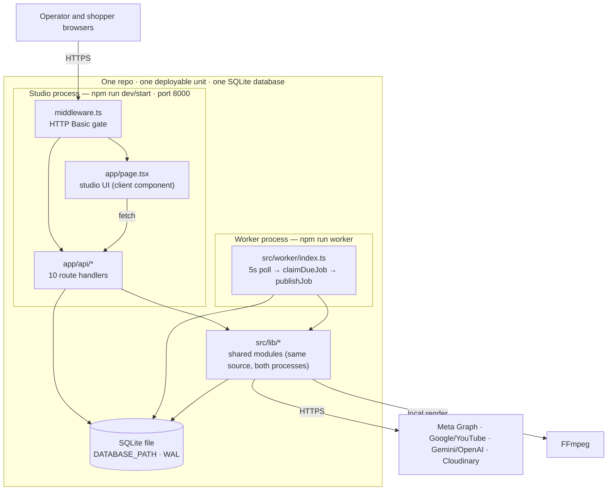
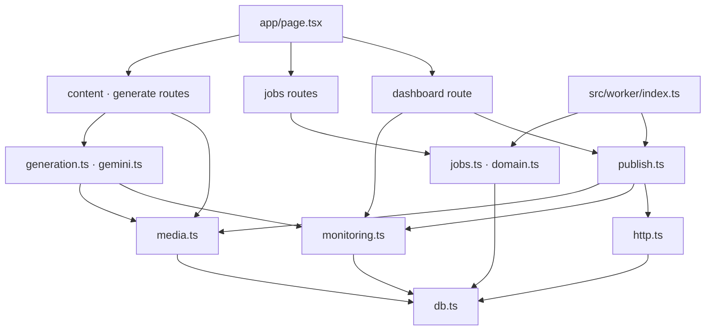
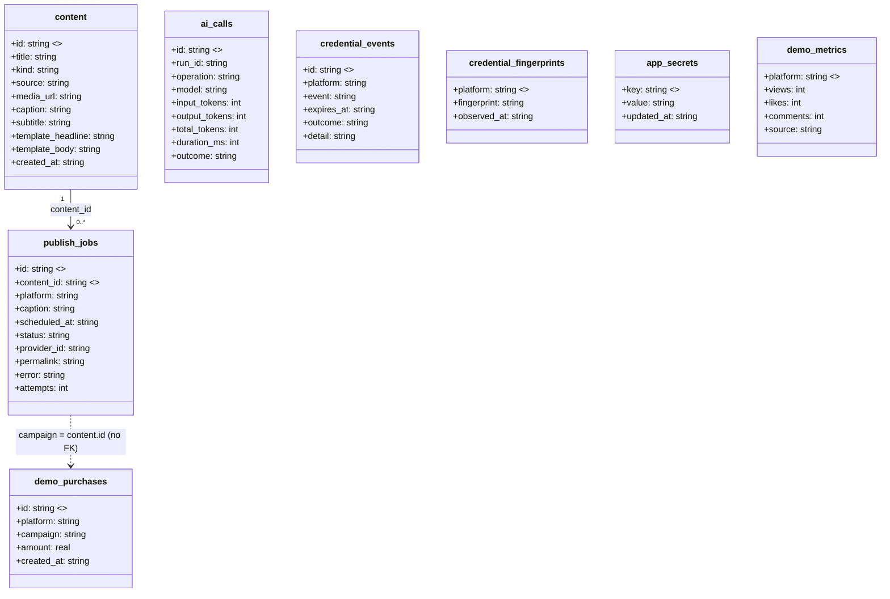
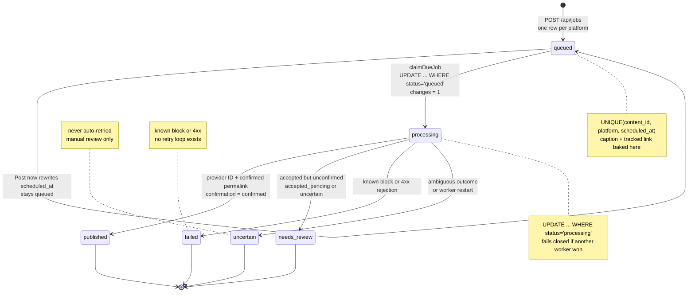
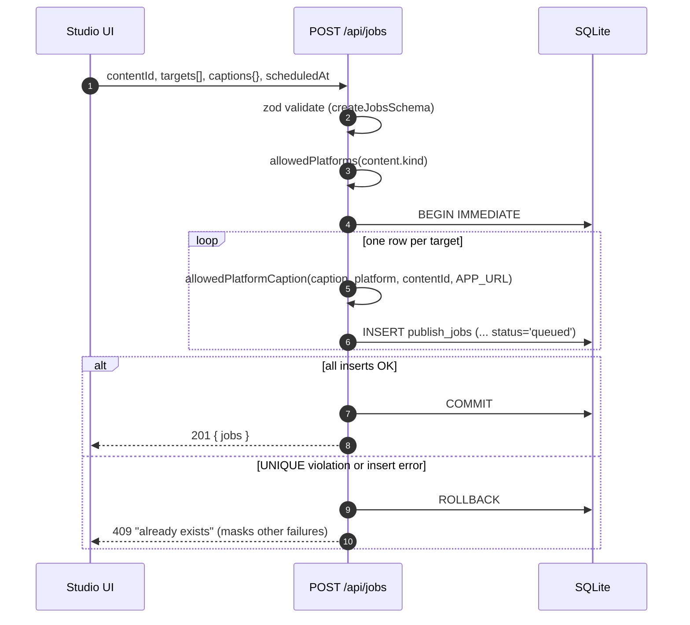
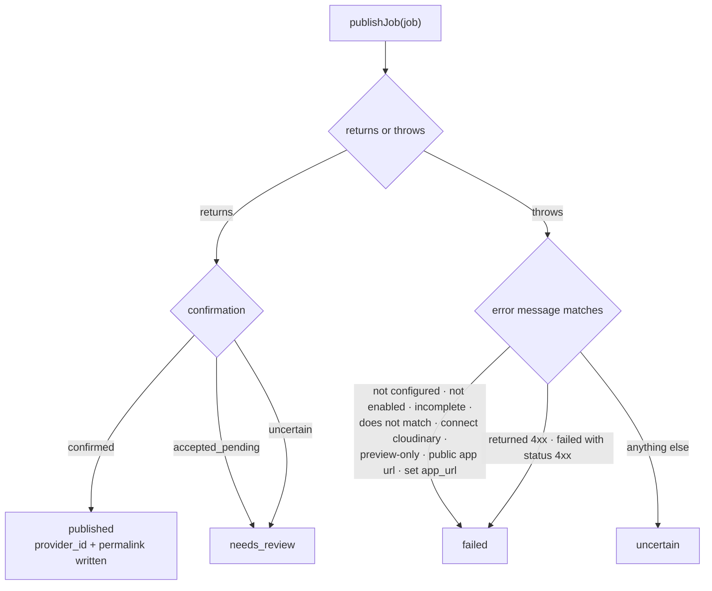
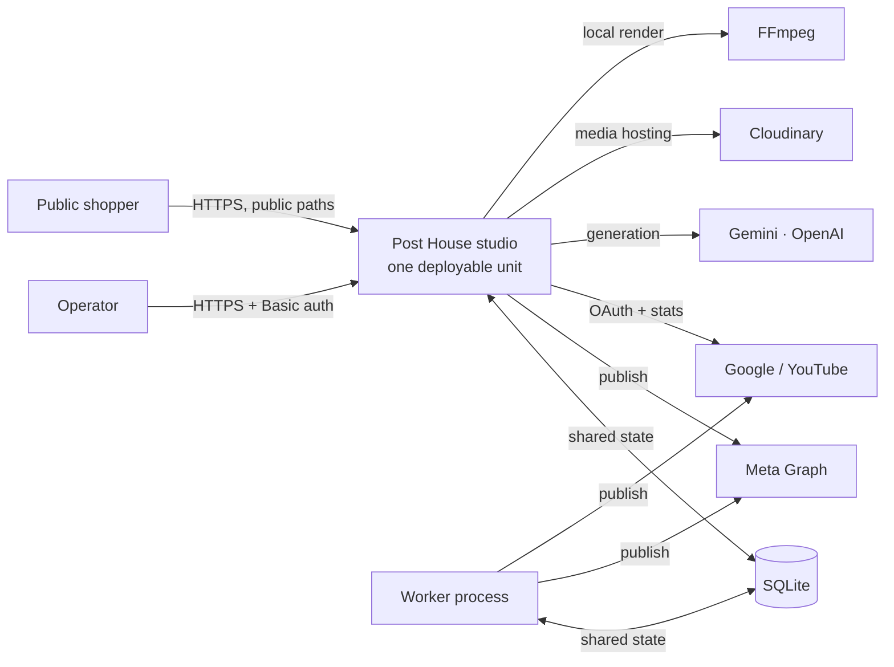

# Module: Architecture

Scope: the cross-cutting shape of the repo — processes, modules, data model, invariants, integration boundaries, and flows. Module behavior lives in `docs/meta-publishing.md` and `docs/demo-readiness.md`; commands and conventions live in `AGENTS.md`. This doc is authoritative for architecture as of commit `c4d3166` (2026-11-12).

Rendered image of D1 (process topology): `docs/architecture.jpg`.

## 1. Verdict — monolithic in deployment, modular in code

**Yes, this is a monolith — and it is not a big ball of mud.** The precise label is a **modular monolith with a sidecar worker process**.

- One repo, one `package.json`, one deployable unit, one SQLite database. No network calls between components, no message queue, no service boundaries.
- Two OS processes: the Next.js studio (HTTP + UI + all domain logic) and a worker (poll-and-publish loop). The worker is **not a service** — it imports the same `src/lib/` source, opens the same SQLite file, and exposes zero HTTP surface.
- The only **runtime** coupling between the processes is the SQLite file (`publish_jobs` rows). Shared `src/lib/` code is compile-time coupling, not runtime coupling.
- The code has real internal boundaries: `src/lib/` modules, zod contracts, isolated platform adapters, a well-defined job state machine.

"Monolithic" splits into four senses; the repo is monolithic in three of them:

| Sense | Verdict | Why |
|---|---|---|
| Deployment | Monolithic | One deployable unit (`npm run dev/start`); the worker is a second process of the same unit, not a separate deployable |
| Data | Monolithic | One SQLite file, one schema owned by `src/lib/db.ts`; no per-component data ownership |
| Code organization | Modular | `src/lib/` has distinct modules with clear ownership; platform adapters are isolated functions |
| Domain | Monolithic | One domain (content studio), one set of entities, no bounded contexts |

What would change the answer: splitting the worker into its own deployable, introducing a queue, or giving the worker its own database/schema.

## 2. Conceptual model

The model before the file listing. Four diagrams: process topology, module map, data model, job lifecycle.

### D1 — Process topology



### D2 — Module map



### D3 — Data model



`metric_snapshots` also exists (`src/lib/db.ts:47`) but is never read or written — dead table.

### D4 — Job lifecycle



### Terminology

| Term | Meaning |
|---|---|
| Studio process | The Next.js process started by `npm run dev` / `npm run start`; owns HTTP, UI, and all domain logic |
| Worker process | The Node process started by `npm run worker`; polls and publishes, no HTTP surface |
| Job | One `publish_jobs` row (one content × platform × scheduled time) |
| Content | One `content` row (an image or video with caption and source) |
| Asset | A generated media artifact (template pubmat, AI artwork, rendered or native video) |
| Live media | A public Cloudinary HTTPS URL; required for publishing |
| Preview media | A local `/api/media/*` URL; preview-only by construction |

## 3. Process topology and coupling

| Process | Entry point | Port | Env loading | HTTP surface | Owns |
|---|---|---|---|---|---|
| Studio | `npm run dev` / `npm run start` (`package.json:6,8`) | 8000 | `.env` / `.env.local` natively (Next.js) | 3 page routes + 10 API routes + middleware | HTTP, UI, all domain logic |
| Worker | `npm run worker` (`package.json:9`) | none | `--env-file-if-exists=.env --env-file-if-exists=.env.local` | none | poll loop, provider calls, status writes |

- **Coupling is the SQLite file only.** The worker imports `db`, `jobs`, and `publish` (`src/worker/index.ts:1-3`), makes no HTTP calls, and opens no port. Both processes open the same `DATABASE_PATH` (`src/lib/db.ts:9-14`, WAL mode). `package.json` has no queue or broker dependency.
- **Startup recovery.** `recoverInterruptedJobs` (`src/lib/jobs.ts:5-8`) flips any leftover `processing` rows to `uncertain` before the first tick, so a crash mid-provider-request fails to review rather than hanging.
- **Throughput bound.** One job per 5 s tick, guarded by an in-process `busy` flag (`src/worker/index.ts:9-14,37`). Provider latency directly bounds publishing throughput; there is no concurrency.
- **Deployment gotchas.** `tsx` is a devDependency (`package.json:24`), so the worker cannot run from a production-only install. `node:sqlite` is experimental in Node 22. There is no graceful shutdown: SIGTERM leaves `processing` rows that only the next worker start recovers.

## 4. HTTP surface and auth boundary

- **One auth layer.** `middleware.ts` is an HTTP Basic gate on `matcher: "/:path*"` and the only check; no route handler re-checks auth. Public exemptions (`middleware.ts:8-9`): `/product*`, `/api/purchase`, `/uploads/*`, `/api/media/*`, `/_next/*`, `/favicon.ico`. It fails closed: 503 when `STUDIO_PASSWORD` is blank and the host is non-local; 401 with `WWW-Authenticate` otherwise. Password compare is SHA-256 + constant-time XOR.
- **Pages (3).** `app/page.tsx` (the entire studio — one 231-line `"use client"` component), `app/setup/page.tsx` (static server component), `app/product/page.tsx` + `app/product/purchase.tsx` (public checkout).
- **API routes (10).**

| Route | Methods | Purpose |
|---|---|---|
| `/api/content` | GET, POST | List content; upload (Cloudinary or local) + copy suggestions |
| `/api/content/[id]` | PATCH | Re-render a template pubmat's text |
| `/api/jobs` | GET, POST | List jobs; create one `publish_jobs` row per target |
| `/api/jobs/[id]/publish` | POST | Make a queued job due now (does not publish) |
| `/api/dashboard` | GET | Fat aggregate: metrics, jobs, usage, credential events, `configured` flags |
| `/api/generate` | POST | Generate template/artwork/video |
| `/api/purchase` | POST | Record a demo purchase (public) |
| `/api/media/[filename]` | GET | Serve local uploads with HTTP Range (public) |
| `/api/oauth/google/start` | GET | Begin Google OAuth (state in `app_secrets` + cookie) |
| `/api/oauth/google/callback` | GET | Exchange code, store refresh token in `app_secrets` |

- **No server actions.** A repo-wide grep finds no `"use server"` directive. Client→server is plain same-origin `fetch` (`app/page.tsx:58` polls `/api/content` + `/api/dashboard` every 12 s).
- **No repository layer.** Routes write raw SQL via `db()` directly (`app/api/jobs/route.ts:23-33`, `app/api/dashboard/route.ts:28-52`, `app/api/content/route.ts:30-31`). Schema is owned by `src/lib/db.ts:15-61`; semantics are spread across routes and `src/lib/`.

## 5. Core flows

### D5 — Schedule flow



### D6 — Publish flow

```mermaid
sequenceDiagram
    autonumber
    participant W as Worker process
    participant DB as SQLite
    participant P as publishJob (src/lib/publish.ts)
    participant X as Platform API
    W->>DB: claimDueJob()<br/>SELECT due queued job
    DB-->>W: job id or none
    W->>DB: UPDATE status='processing'<br/>WHERE status='queued'
    alt changes = 0
        W-->>W: another worker won; skip
    else changes = 1
        W->>DB: JOIN content for media and caption
        W->>P: publishJob(job)
        P->>P: env check + assertLiveMediaUrl
        P->>X: provider request(s)
        X-->>P: provider ID / permalink / confirmation
        P-->>W: { result, status }
        W->>DB: UPDATE status WHERE status='processing'
    end
```

### D7 — Outcome taxonomy

How a `publishJob` result or thrown error becomes a terminal status (`src/worker/index.ts:25-27`, `src/lib/publish.ts:168-170`):



The taxonomy is **string matching on provider error text**. Rewording a publisher's error message silently changes job outcomes.

### Flow table (≤3 hops each)

| Flow | Entry point | Chain |
|---|---|---|
| Generate | `POST /api/generate` | `createGeneratedAsset` (`generation.ts`) → `gemini.ts` / FFmpeg → `media.ts` → `content` row |
| Schedule | `POST /api/jobs` | `createJobsSchema` (`domain.ts`) → `allowedPlatformCaption` → `publish_jobs` rows |
| Publish | worker tick | `claimDueJob` (`jobs.ts`) → `publishJob` (`publish.ts`) → provider API → status write |
| Post now | `POST /api/jobs/[id]/publish` | `UPDATE scheduled_at=now WHERE status='queued'` → worker picks it up ≤5 s later |
| Purchase → dashboard | `POST /api/purchase` (public) | `demo_purchases` row → `/api/dashboard` groups by platform → studio metrics |
| Google OAuth | `GET /api/oauth/google/start` | state in `app_secrets` + cookie → callback → refresh token in `app_secrets` |

## 6. Integration boundaries

| System | Direction | Credentials | Called by | Failure behavior |
|---|---|---|---|---|
| Meta Graph (FB/IG) | outbound publish | paste-in env (`META_*`), **no OAuth route** | worker | blocked → `failed` |
| Google OAuth + YouTube Data API | OAuth + outbound | `GOOGLE_*` + refresh token in `app_secrets` | studio (OAuth), worker (publish), dashboard (live stats) | no token → `configured.google=false` |
| Gemini / OpenAI | outbound generation | `GEMINI_*` / `OPENAI_*`, `AI_PROVIDER` selects order | studio | falls back provider-by-provider, then deterministic copy |
| Cloudinary | outbound upload | `CLOUDINARY_*` | studio | falls back to local `/api/media` (preview-only) |
| FFmpeg | local subprocess | — | studio | template/artwork/video rendering fails the request |

- **Live media gate.** `assertLiveMediaUrl` (`src/lib/publish.ts:162-166`) requires a public Cloudinary HTTPS URL **and** a non-local HTTPS `APP_URL`. Locally stored media is preview-only by construction (`media.ts` `loadPublicMedia` refuses anything not `res.cloudinary.com`).
- **Platform adapters.** `facebook()` / `instagram()` / `youtube()` are isolated functions dispatched by a switch in `publishJob` (`src/lib/publish.ts:168-170`); the platform enum lives in `src/lib/domain.ts`. Adding a platform means extending the enum and the switch.
- **Meta detail** (permissions, token minting, demo scope) is owned by `docs/meta-publishing.md`; this doc states only the boundary fact.

### D8 — System context



## 7. Invariants and rough edges

**Invariants — rules that must not be broken:**

- **Optimistic, fail-closed transitions.** `claimDueJob` updates only `WHERE status='queued'` and requires `changes === 1` (`src/lib/jobs.ts:10-14`); the worker writes results only `WHERE status='processing'` (`src/worker/index.ts:20,28`). A racing claim loses and publishes nothing.
- **One job row per content × platform × scheduled time.** `UNIQUE(content_id, platform, scheduled_at)` (`src/lib/db.ts:25`) plus the `jobs_due` index.
- **Tracked links are baked at schedule time.** `allowedPlatformCaption` (`src/lib/domain.ts`) appends the `/product?platform=…&campaign=<contentId>` link and truncates only the user's caption to fit platform limits. Changing `APP_URL` later does not update queued jobs.
- **Terminal states are never auto-retried.** `published`, `failed`, `uncertain`, `needs_review` are final; `attempts` is incremented but never read, so there is no retry loop.
- **A job becomes `published` only on a provider ID and a confirmed permalink / public processing state.** Ambiguous outcomes become `uncertain` or `needs_review`.

**Rough edges an onboarding engineer must not trip on:**

- `markJobStarted` (`src/lib/publish.ts:173`) is dead code; `AGENTS.md:44` still cites it. The real claim path is `claimDueJob`.
- `metric_snapshots` is created (`src/lib/db.ts:47`) but never read or written. `ai_calls.estimated_cost_usd` is always null.
- `GET /api/dashboard` has write/network side effects: it refreshes Google access tokens (writing a `credential_events` row each time) and calls the YouTube API on every 12 s poll when published YT jobs exist (`app/api/dashboard/route.ts:14-17`).
- `/api/jobs` returns 409 for **any** insert failure, masking non-duplicate errors such as a too-long caption (`app/api/jobs/route.ts:35-37`).
- Local media is double-served: `/api/media` (range-capable) and `/uploads` (static, because `UPLOAD_DIR` defaults inside `public/`).
- OAuth state is a single global `app_secrets` key, not per-session; the callback is not middleware-exempt.
- **Scaling implications.** One deployable means the studio and worker scale together; the worker's 5 s single-job loop bounds publish throughput; the shared SQLite file is the single serialization point. Splitting any of these is the path out of the monolith, and none of it is currently needed for a single-operator studio.

## 8. Documentation status and stale claims

**Ownership.** This doc owns topology, module map, data model, invariants, flows, and integration boundaries. `docs/meta-publishing.md` owns Meta credential paths and permission gotchas. `docs/demo-readiness.md` owns the demo E2E audit and runbook. `AGENTS.md` owns commands and conventions. Any claim that appears in two places must be a link, not a copy.

**Stale claims in existing docs — corrected here, not repeated:**

| Where | Stale claim | Current fact |
|---|---|---|
| `docs/demo-readiness.md:23` | Worker does not load `.env` | `package.json:9` passes `--env-file-if-exists=.env --env-file-if-exists=.env.local` |
| `docs/demo-readiness.md:24` | App runs on port 3000 | `package.json:6,8` pins `-p 8000`; the OAuth redirect URI matches |
| `docs/demo-readiness.md:25` | `GEMINI_*` / `AI_PROVIDER` are inert | `src/lib/generation.ts:14` has a Gemini-first `providerOrder()` (commit `c4d3166`) |
| `docs/demo-readiness.md:10` | 7/7 tests | 18 test cases across 5 files |
| `docs/meta-publishing.md:24` | Unconfigured Meta maps to `uncertain` | The worker maps blocked messages to `failed` (`src/worker/index.ts:25-27`); the doc's own addendum at `:71` says the same |
| `AGENTS.md:44` | Cites `markJobStarted` as the optimistic transition | `markJobStarted` is dead; the real path is `claimDueJob` (`src/lib/jobs.ts:10-14`) |
| `AGENTS.md:57,68,77` | Repeats the stale worker-`.env` and Gemini claims | See the rows above |
| `SETUP.md:3,7` | Hardcodes `/home/adrian/codes/wework-hackathon` | The repo lives at `/mnt/hdd/repo/wework-hackathon` |

## 9. Subsystem locator

| I want to … | Look at |
|---|---|
| Add a platform | `src/lib/domain.ts` (enum) + `src/lib/publish.ts` (switch + adapter) |
| Change job status rules | `src/lib/jobs.ts`, `src/worker/index.ts:25-28` |
| Change caption/tracked-link rules | `src/lib/domain.ts` (`allowedPlatformCaption`) |
| Change the schema | `src/lib/db.ts` (tables + ad-hoc migrations) |
| Change generation / AI fallback | `src/lib/generation.ts`, `src/lib/gemini.ts` |
| Change media hosting | `src/lib/media.ts` |
| Change auth / public paths | `middleware.ts` |
| Trace a publish failure | `src/worker/index.ts:25-27` (taxonomy) → `publish_jobs.error` |
| Understand the demo flow | `docs/demo-readiness.md` |
| Understand Meta credentials | `docs/meta-publishing.md` |

**Tests** pin the load-bearing invariants: `tests/jobs.test.ts` (claim one-shot, restart recovery), `tests/domain.test.ts` (platform rules, caption limits), `tests/monitoring.test.ts` (no secret leakage), `tests/gemini.test.ts` (request shapes, usage recording), `tests/generation-fallback.test.ts` (provider fallback, FFmpeg render). Route handlers are invoked directly with constructed `Request` objects.
